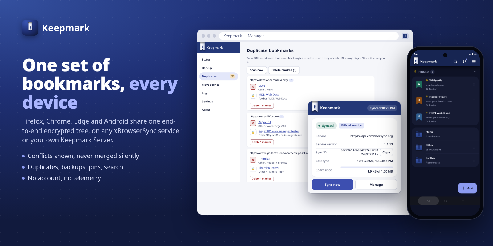
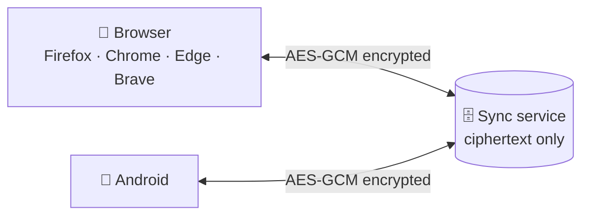
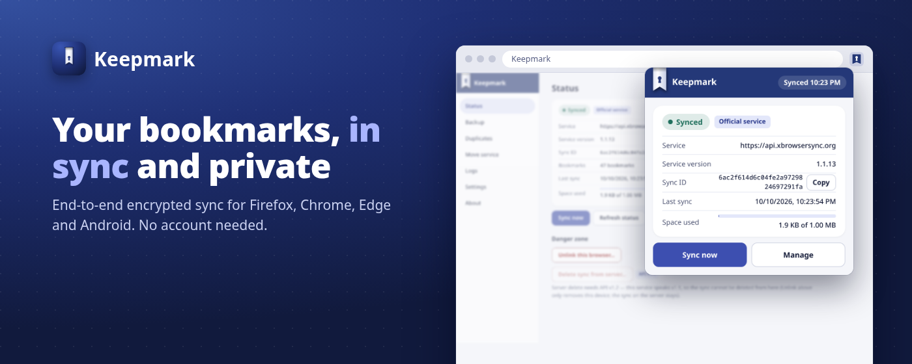
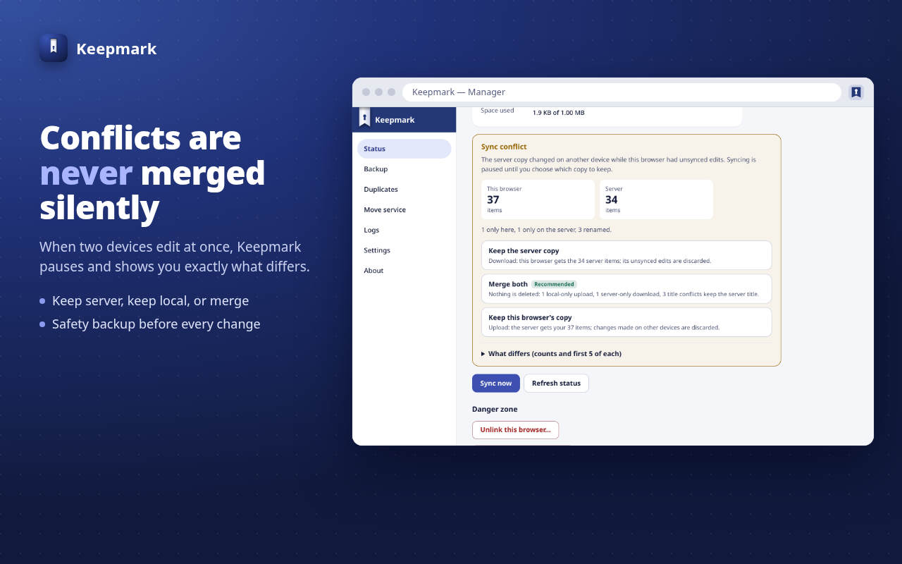
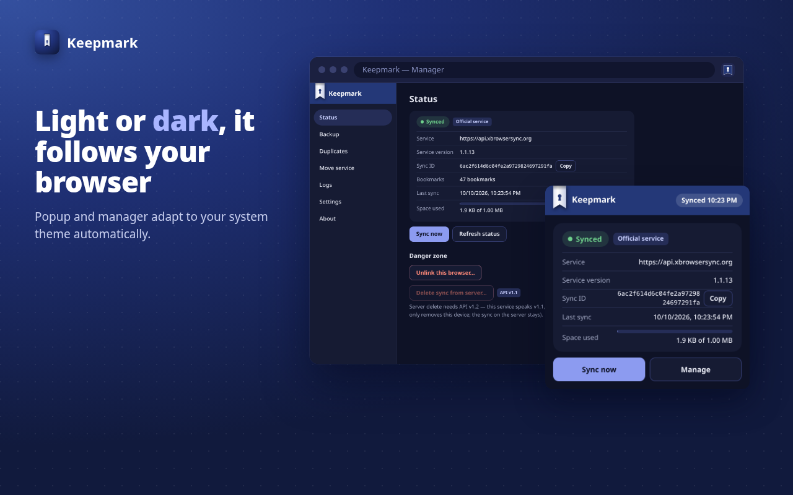
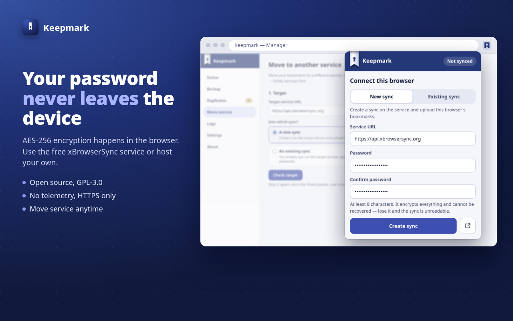
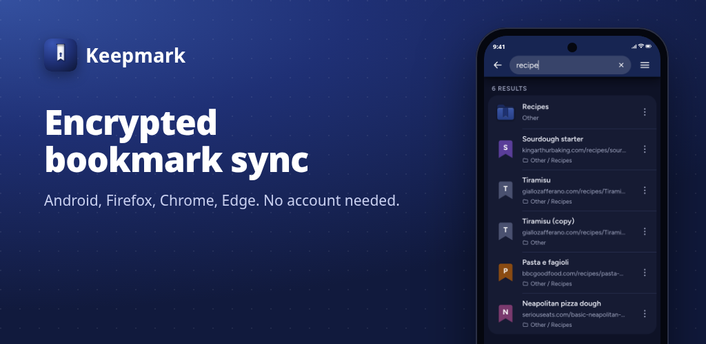
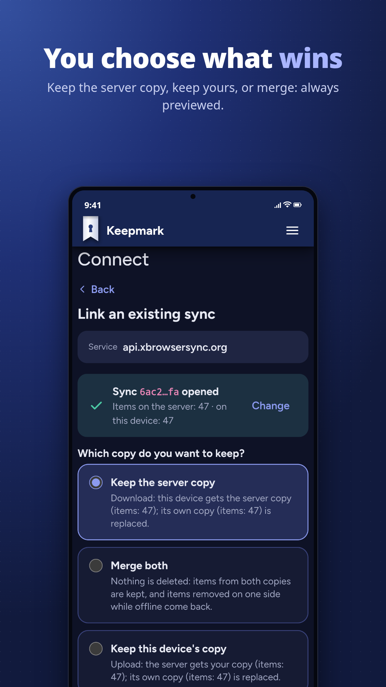
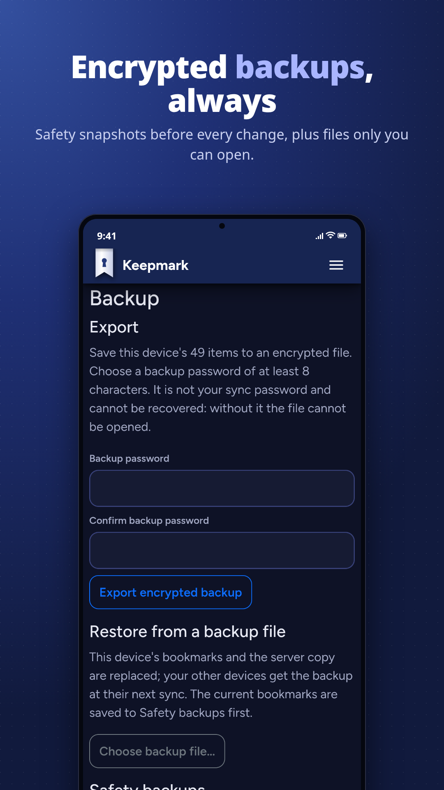

<p align="center">
  
</p>

<h1 align="center">Keepmark</h1>

<p align="center">
  <b>Your bookmarks on every browser and your phone, synced and end-to-end encrypted.</b><br />
  No account needed. Compatible with xBrowserSync.
</p>

<p align="center">
  <a href="https://github.com/Keepmark/KeepmarkApp"></a>
  <a href="https://github.com/Keepmark/KeepmarkMobile"></a>
  <a href="https://github.com/Keepmark/KeepmarkApi"></a>
</p>

<p align="center">
  
</p>

---

## How it works

Your bookmarks are encrypted **on your device**, with a password that never
leaves it. The sync service stores only ciphertext and a random sync ID: no
email, no account, no way to read your data.



1. **Create a sync** in any Keepmark app: you get a sync ID and choose a password.
2. **Link your other devices** with the same sync ID and password.
3. **Done.** Changes flow everywhere; conflicts are never resolved behind your back.

It works with **any xBrowserSync service** (the official one, a community
host or your own) and with the official xBrowserSync apps. A sync created in
Keepmark opens there, and the other way round. Nothing to migrate.

---

## 🧩 Keepmark for browsers

<p align="center">
  <a href="https://github.com/Keepmark/KeepmarkApp"></a>
</p>

Firefox (MV2) and Chrome, Edge, Brave (MV3). Toolbar, menu and other
bookmarks sync automatically; the toolbar icon tells you at a glance whether
you are in sync.

- **Honest conflicts:** keep server, keep local or merge, with a preview first.
- **Safety backups** before every destructive step, plus encrypted export and import.
- **Duplicate cleanup**, service migration, change password, activity log.

<p align="center">
  
  
</p>
<p align="center">
  
  
</p>

<p align="center"><a href="https://github.com/Keepmark/KeepmarkApp"><b>→ Keepmark/KeepmarkApp</b></a></p>

---

## 📱 Keepmark for Android

<p align="center">
  <a href="https://github.com/Keepmark/KeepmarkMobile"></a>
</p>

The same bookmarks in your pocket. Encrypted local database (SQLCipher),
credentials in the Android KeyStore, app lock with fingerprint or PIN.

- **Made for the phone:** full-text search, pinned bookmarks, breadcrumb, swipe for details.
- **Share to Keepmark** from any app: the add form opens already filled in.
- **Backups** compatible with the browser extension, safety snapshots, undo.

<p align="center">
  
  
  
  
</p>

<p align="center"><a href="https://github.com/Keepmark/KeepmarkMobile"><b>→ Keepmark/KeepmarkMobile</b></a></p>

---

## 🗄️ Keepmark Server

A drop-in xBrowserSync sync service: same contract, safer writes, easier to
run. Official xBrowserSync apps and Keepmark apps work unchanged.

- **No silent overwrites:** every conditional write is an atomic compare-and-swap.
- **Opt-in v1.2 API:** revisions, conflict detection, cheap `HEAD` / `304` checks, sync deletion.
- **Built to be public:** per-IP throttling, daily new-sync quota, origin allow-list, redacted logs.
- **Easy to operate:** Docker Compose with MongoDB, healthchecks and rolling backups.

```sh
git clone https://github.com/Keepmark/KeepmarkApi.git && cd KeepmarkApi
cp .env.example .env          # set real passwords
docker compose up --build -d
curl localhost:8080/info
```

<p align="center"><a href="https://github.com/Keepmark/KeepmarkApi"><b>→ Keepmark/KeepmarkApi</b></a></p>

---

## At a glance

| | [Browser](https://github.com/Keepmark/KeepmarkApp) | [Android](https://github.com/Keepmark/KeepmarkMobile) | [Server](https://github.com/Keepmark/KeepmarkApi) |
|---|:---:|:---:|:---:|
| End-to-end encryption | ✅ | ✅ | stores ciphertext only |
| Works with any xBrowserSync service | ✅ | ✅ | serves any xBrowserSync client |
| Conflict preview, safety backups | ✅ | ✅ | revision-based CAS (v1.2) |
| Encrypted backup export / import | ✅ | ✅ | — |
| Languages | 9 | 9 | — |

Languages: English, Italiano, Français, Español, Deutsch, 日本語, Português
(Brasil), Русский, 简体中文.

## Contact

Questions, bug reports or feedback: open an issue in the relevant repository
or write to [keepmark@proton.me](mailto:keepmark@proton.me).

<sub>Keepmark is an independent project built on the xBrowserSync protocol. Not affiliated with or endorsed by xBrowserSync.</sub>
